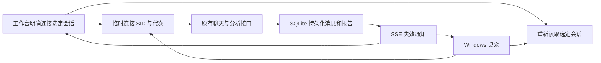

# FinPilot v15：2D 鲸鱼娘桌宠技术与功能报告

**2026-11-19 启动方式更新：** 当前主启动器默认同时打开后端、悬浮 2D 助手与浏览器。关闭启动窗口、按 `Ctrl+C` 或执行 `stop-finpilot.cmd` 会结束本次后端和助手；后端退出也会关闭助手。只关闭浏览器页面不会停止项目；托盘「退出桌宠」仅关闭助手。重复启动复用本项目实例，修改配置或源码后请先停止再重启。可用 `-NoDesktop` 只启动网页。默认运行当前宿主源码，旧 v15 Portable EXE 未重建，不能用旧 EXE 验证新联动。完整操作见 [当前 README](../README.md) 和 [桌宠说明](../desktop/README.md)。下面的构建、验收和启动记录保留为 v15 历史证据。

本期按用户确认的范围实现 **Windows 独立桌宠、网页同款形象及明确选定会话的共享金融问答**。用途为课程与个人非商业演示。新角色只采用真实多帧 2D 序列，不包含或冒充新的 3D 模型；原有机器人 2D/3D 保留为旧版展示选项。

本文记录 2026-11-11 的实现。最终服务端 **717 项测试通过**；工作台与实际打包 Electron 渲染器完成两轮真实 DeepSeek 问答，共三次生成、一次受限修正，零新增 IBKR 请求。受控界面、真实 SSE/持久化、原生进程、实际模型与提交包分别记录，不能相互替代。

原生结论为 **`passed_with_manual_hardware_limits`**：九项进程内 instrumentation 通过，但包含模拟光标/拖动与显式窗口探测，不认证物理鼠标、托盘、精确 alpha 边界或多硬件效果。最终证据索引见 [v15 综合验收](../reports/companion_acceptance_v15.json)，具体限制见第 8 节。

## 1. 用户可见功能

| 功能 | 实现行为 | 重要边界 |
| --- | --- | --- |
| Windows 桌宠 | 透明置顶、拖动、落地、屏幕边缘约束、尺寸和位置保存；托盘显示/隐藏/恢复/退出 | 默认约 200 逻辑像素舞台、不抢焦点；安静散步默认关闭，声音与开机启动未自动开启 |
| 本地互动 | 单击回应，双击或 Enter 打开聊天；可选散步和休息 | 播放动作、打开面板不会调用模型或 IBKR |
| 金融问答 | 气泡内发送普通问题、金融问题及对绑定报告的追问 | 调用现有后端，保留真实引擎、失败/离线提示、数值与来源；不另建一个模型代理 |
| 报告联动 | 点击“解释本报告”，读取服务器会话当前绑定的分析 | 不自动采集行情；历史缺失 OI 和不可比指标继续保持原样 |
| 共享会话 | 工作台明确点击“连接当前会话”后，桌宠继续同一 SID 的问答与报告 | 不自动扫描或选择其他聊天；切换网页会话不让桌宠悄悄跟随 |
| 网页角色 | 工作台与 `/demo` 默认显示同款鲸鱼娘；支持减少动态和旧版形象切换 | `/demo` 仍为独立演示会话，不自动加入共享连接 |
| 快捷入口 | 打开完整工作台、计算器和历史复盘 | 不因为打开入口就生成回答或收集市场数据 |

角色的思考、聆听、朗读和错误状态只描述操作。它们不表示投资风险、市场多空、模型置信度或收益保证。朗读时使用已有动作近似表达，不宣称音素级唇形同步。

## 2. 既有素材与单独许可

主素材来自 [YunYueSama/codex-deepseek-pet](https://github.com/YunYueSama/codex-deepseek-pet)，固定版本 `7661c8b304c5400701f91da01b1a643a207331de`。保留参考图所需的蓝紫长发、蓝瞳、鲸鳍、鲸尾、女仆头饰及白色鲸鱼围裙，没有重新生成人物或改变服装配色。

构建按上游实际动作表选择并重排帧：动画格为 256px，高清待机和静态立绘为 512px，输出 WebP。运行图像共 **1,140,772 字节，约 1.09 MiB**，低于 12 MiB 目标；没有搬入完整约 151 MiB 的上游素材目录。待机先加载，其他动作按需读取本地资源；每次仅绘制完整角色的一帧，避免叠帧双轮廓。

来源、输入 Git blob 哈希、输入/输出 SHA256 和修改说明记录于 [provenance.json](../web/companion/provenance.json)。原始缓存位于 `tmp/`，不作为应用运行素材分发。重建需要 Node.js 与 Pillow 11.3.0；查看已交付页面无需下载素材或安装这些构建工具。

```powershell
.\.venv\Scripts\python.exe scripts/prepare_companion_assets.py
```

许可需要分别保留，不能仅写“来源网络”或假设开源代码覆盖角色：

- 动作与立绘新增贡献：**YunYueSama**，[上游自定义署名许可](../web/companion/licenses/YUNYUESAMA-LICENSE.txt) 与 [素材范围说明](../web/companion/licenses/UPSTREAM-ASSET_LICENSE.md)。
- 原设“溟月”：**上善无形**，[原作者许可声明](https://www.bilibili.com/opus/1231977657712771073)。
- 女仆版设计：**ZipZipPipe**，[形象使用声明](https://www.bilibili.com/opus/1247156596114456581)。
- 底层角色采用 **CC BY-NC-SA 4.0**。本次改编图集按相同条件提供，保留完整许可和改动记录；作者新增贡献的许可不消除底层非商业限制。完整 [归属清单](../web/companion/licenses/ATTRIBUTION.md) 和 [CC 许可文本](../web/companion/licenses/CC-BY-NC-SA-4.0.txt) 随素材附带。

DeepSeek 名称与标志仍归相应权利人，本项目不是 DeepSeek 官方产品。上述是素材使用范围，不将整个金融应用代码误标为 CC 素材许可。

[Coopanion](https://github.com/Pal-AI-Lab/Coopanion) 是透明窗口、拖动、穿透和托盘交互的设计参考。本实现没有整包引入其 AGPL 桌面代理、Cortico Core、模型账号或未随代码授权的鲸鱼贴图。

## 3. 渲染、窗口与生命周期

共用 `FinPilotCompanion.mount()` 创建 Canvas 2D 角色，提供 `setState`、`playAction`、`setLanguage`、`setReducedMotion`、`getStatus` 和 `destroy`。状态及真实渲染器通过 `finpilot-companion-status` 发出。`getStatus()` 如实记录当前动作、绘制帧、帧变化、暂停、素材版本和降级原因。

- 正常路径：本地多帧图集，不用单张图片摆动或视频伪装完整角色动画。
- 减少动态：停止动画推进，状态文字与静态姿势仍可更新。
- 隐藏/离屏：暂停不必要的绘制；销毁时清理监听、观察器、请求及动画循环。
- Canvas 或动作资源失败：退回同角色静态立绘；立绘也失败时说明不可用，聊天仍可继续。不能把静态降级写成动画验证通过。

Windows 宿主为 Electron **45.3.0**，打包器为 electron-builder **26.18.0**，依赖由 `desktop/package-lock.json` 固定。宿主仅管理本身的透明工作区窗口、托盘与有限原生桥，不提供通用文件、命令执行或电脑操作 API。

透明区命中根据角色本帧 alpha 生成近似横条，再加聊天和菜单区域；主进程读取系统光标坐标决定接收或穿透。它不读取屏幕背景、其他窗口内容或账户信息。拖动有结束/租约恢复路径，避免渲染器异常后长期挡住鼠标；全穿透可通过托盘恢复。

一次原生观察发现：角色位于屏幕左侧时，原先始终向左放置的面板被屏幕边缘夹回，遮住角色。修复后先选能完整容纳的右/左侧，两侧不足时优先上方，窄屏使用有明确收起按钮的面板。修复前状态、受控回归和原生刷新后的不重叠观察见 [布局回归记录](../reports/pet_layout_regression_v15.json) 与 [原生报告](../reports/native_companion_v15.json)。这些不等于物理拖动或点击命中已经认证。

## 4. 共享会话与数据一致性



连接只维护一个用户明确选定的 SID、语言和引擎。它存于本地服务内存，服务重启后不会自动扫描旧聊天恢复绑定。浏览器与 Electron 使用不同用户目录，因此采用后端 SSE，而不是依赖不能跨浏览器配置档的 BroadcastChannel。

事件只传连接、活动和失效通知，不广播完整聊天正文。数据仍以数据库为准：客户端读取选定会话，按持久化消息 ID 替换/更新显示，不把 POST 返回和 SSE 通知分别追加成重复回答。事件带服务启动标识 `epoch`、递增 `seq` 和连接 `generation`；旧连接、旧操作及迟到响应不能覆盖新状态。断线重连会重新同步，但不会自动重发问题。

共享聊天 **省略 `analysis_id`**，让服务器在既有会话锁内读取真实当前绑定。仅用户明确切换报告时执行显式绑定，避免另一端旧页面把新分析回绑成旧版。旧回答继续保存自己的 `analysis_context`、时间、来源和数值。

刷新有两个已提交阶段：新报告原子保存并绑定后立即通知 `analysis.changed`；模型回答持久化后通知 `session.changed`。模型失败不等于新报告没有保存。广播使用有界队列，不等待慢客户端，不阻塞数据库提交或模型响应。没有为了同步新增数据库 revision 迁移。

## 5. 接口变化

| 接口 | 用途 |
| --- | --- |
| `GET /pet` | 同源桌宠页面；浏览器可预览，但不能因此声称已有系统置顶/托盘 |
| `GET /api/companion/connection` | 连接状态、epoch/seq/generation、SID、语言、引擎、原生在线和活动摘要 |
| `PUT /api/companion/connection` | 明确设置 SID 或 `null`；可带语言、引擎及防迟到的 `expected_generation` |
| `GET /api/companion/events?surface=desktop\|workspace` | SSE，15 秒心跳；重连发送 reset 供权威同步 |
| `POST /api/companion/activity` | 受限操作 ID、类型、状态、SID 和代次；不是任意消息或工具接口 |
| `GET /api/health` | 增加 `application: "FinPilot"`，供启动器确认服务身份；配置状态仍不等于模型连通性 |

已有 `/api/chat`、会话、计算与期权接口继续使用。会话/绑定/删除事件在持久化成功后发布；删除已连接会话同时清除连接。前端活动限于计算、期权、历史、检索和语音，不能通过活动接口请求模型或交易。

网页保留 classic/defer 脚本形态，避免破坏期权模块使用的既有全局入口。共用回答渲染只提取有限 Markdown、模式/警告、来源和分析证据，不把整个工作台放进桌宠。模型 HTML 不执行；危险链接和未知引用不变成原生能力。

### 金融文字检查的狭窄修正

真实问答暴露了有限词法规则的两类问题，而不是行情接口重新采集失败：

- “不能据此说成交放大或看跌占比上升”是对变化推断的明确否定，原先却被当作肯定方向。修正只扩展受金融指标尾部约束的“说/断言”，没有给任意免责声明豁免。
- “历史成交条接口文档没有列出按日持仓类型”、独立持仓日期、区间成交汇总与同步报价的区别，以及“历史不是当前行情”等明确关系存在同义漏识。已补对应主题匹配，错误来源、未知 ID、纯元数据和其他领域仍不能据此通过。

这些修正并不保证原答案通过：较早第二次输出删除了正确历史 OI 来源后，仍应拒绝；另一个曾机器接受的首问按更新后的规则发现 bars 来源缺口，不计入最终通过。最终 **330 项相关定向回归**包括正负用例、历史与快照消费者、未来保证/资金流拒绝；它不是金融预测准确率。离线重放与原始失败边界分别记录在 [方向否定审计](../reports/direction_denial_v15.json) 和 [来源同义审计](../reports/expert_synonyms_v15.json)。离线修改引用的副本从未冒充实际云模型成功。

## 6. 启动、交付与边界

先按 README 安装项目 Python 环境、配置服务，再执行：

```powershell
powershell -NoProfile -ExecutionPolicy Bypass -File .\start-desktop.ps1
```

启动器默认检查 `127.0.0.1:8000`，只有健康接口明确标识 FinPilot 才复用；没有监听服务时使用项目已有 Python 环境启动后端。其他程序占用端口会报错，不终止该程序。可用 `-Port 8001` 指定另一端口，`-Python` 指定已安装依赖的解释器。升级代码后，旧版后端须由其所有者重新启动；启动器不会为升级擅自结束已有服务。

已构建的 `desktop/artifacts/FinPilotPet-15.0.0-win-x64-portable.exe` 为 **109,966,509 字节**，SHA256 为 `64b4f47bc9d7522c9c62c6f3a63903a5fcca952865d84f92dcd5892cb92b80f0`。**便携宿主不包含 Python、项目后端或基座模型，仍依赖本地项目环境；它不是无需 Python 的自包含单文件应用。** 默认退出桌宠保留共享后端。打包器未配置代码签名，具体平台兼容性按实际测试范围说明。

开发及重建：

```powershell
Set-Location desktop
npm ci
npm test
npm run dist
Set-Location ..
```

桌宠启用沙箱、上下文隔离，关闭 Node 集成，限制导航和原生 IPC。DeepSeek 密钥只由 Python 后端读取，不进入预加载桥、浏览器或宿主资源包。现有 Host、同源与 CSP 限制保留；未引入读屏、其他窗口枚举、电脑操作代理、额外登录或语音模型下载。

## 7. 金融解释的适用范围

桌宠改变入口和交互，不把历史数据升级为实时行情，也不扩大专家 RAG 的证明能力。仍使用现有实际 IBKR 历史存档、共同合约样本与有界来源检查；历史 OI、同步双边报价或其他缺失保持缺失，覆盖不足时不生成可比变化结论。

本地动作、启动、连接、SSE 重连和打开快捷入口不请求模型或 IBKR。发送问题或“解释本报告”才进入所选引擎；失败保持实际模式和警告，不能把离线摘录称为 DeepSeek 成功。刷新/导入仍由现有工作台明确触发，历史报告不提供伪装实时刷新。

专家主题检查仍是有限规则，不是通用语义蕴含或金融预测准确率。对 v14 相关数据和来源边界，继续参阅 [专家 RAG 报告](innovation_rag_v14.md) 和 [历史分析说明](history_rag_v13.md)。

## 8. 验证证据与实际限制

| 验证层 | 已有证据与状态 |
| --- | --- |
| 素材/渲染 | [renderer 报告](../reports/companion_renderer_v15.json)：17 项通过，真实 Canvas2D、本地资源、三种视口及静态降级；0 模型/IB |
| 工作台与演示页 | [workspace 报告](../reports/workspace_companion_v15.json)：24 项 × 320/390/1440 通过；API 受控，不是实际云问答 |
| 桌宠网页 | [pet 报告](../reports/pet_browser_v15.json)：15 项 × 三视口通过，含左侧角色面板避让、草稿及安全渲染；API 受控 |
| 跨浏览器共享 | [sync 报告](../reports/companion_sync_browser_v15.json)：12 项通过，独立 Edge 配置档、真实 SSE/HTTP/持久化；提供者为受控输出，0 外部模型/新行情 |
| 构建与宿主契约 | [build 报告](../reports/desktop_build_v15.json)：4 项 Node 契约、锁版本、ASAR 和错误服务拒绝路径通过；不等于原生效果实测 |
| Windows 原生进程 | [native 报告](../reports/native_companion_v15.json)：`passed_with_manual_hardware_limits`；九项 instrumentation、可见/置顶/焦点等进程状态及修复后面板观察；光标、拖动与托盘回调含模拟，不能写成真实硬件通过 |
| 真实模型/真实历史资料 | [最终 cloud 报告](../reports/pet_cloud_v15.json)：实际 Edge 与打包 Electron 渲染器，两轮 DeepSeek，无 warning，共三次生成/一次修正；原档案不变，两端各四条持久化消息无重复，零新增 IB |
| 最终服务端回归 | [JUnit 结果](../reports/tests_v15-20261111T125451165585Z.xml)：717 项通过；定向 330 项是其中相关检查，不另算预测正确率 |
| 交付包 | 构建产物与完整提交包分开；打包完成后以独立 `dist/package_check_v15.json` 的实际结果、包 SHA256 和隔离启动检查为准，不由本段预先宣称包校验通过 |

真实模型验证累计六个脚本自有聊天 HTTP 请求、十一次服务端报告的生成尝试、五次修正，包含失败；最终通过运行仅占其中两次聊天、三次生成和一次修正。它们不是账单 token 或普遍回答正确率。完整 [失败与调用历史](../reports/cloud_validation_history_v15.json) 保留此前失败和被更新规则否定的旧机器结果，最终只有当前策略下的两轮计作通过。

Windows 观察环境为单个物理显示器、缩放因子 1.5。曾在受控下层窗口观察到按钮计数从零变一，但当时未同步采样宠物的 OS 可见/置顶状态，**不能据此认证可见宠物的物理点击穿透**。物理拖放、托盘打开/恢复、alpha 边界精度、第二显示器、其他硬件 DPI、其他 Windows 版本及真手机均未认证。移动检查为桌面 Edge 的响应式视口；不使用私人软件背景截图弥补这些限制。

交付收尾时已通过 `start-desktop.ps1` 启动连接 8000 端口的可见桌宠。最后一次 UIA 检查被用户按 Esc 中断，因此不记作最终人工检查通过，也不补做计算机操作。

其他失败和修复记录也保留，包括首次 renderer 脚本、跨客户端同步的初次运行及原生面板遮挡。实际进程 instrumentation 与界面脚本证明相应软件行为，不能代替未执行的硬件验收。

## 9. 演示与复现

按 [v15 演示脚本](demo_v15.md) 展示。常规受控检查不会消耗模型额度：

```powershell
.\.venv\Scripts\python.exe scripts/check_companion_renderer_v15.py
.\.venv\Scripts\python.exe scripts/check_workspace_companion_v15.py
.\.venv\Scripts\python.exe scripts/check_pet_browser_v15.py
.\.venv\Scripts\python.exe scripts/check_companion_sync_v15.py
.\.venv\Scripts\python.exe scripts/check_desktop_build_v15.py
```

浏览器检查需要已有本地服务及 `requirements-ui-tests.txt`。共享检查使用隔离服务与数据库；构建检查读取当前已构建文件并运行受控的错误服务，不打开真实账户、不请求模型。重新运行检查会写对应新报告，应保留此前有审计价值的失败结果。
