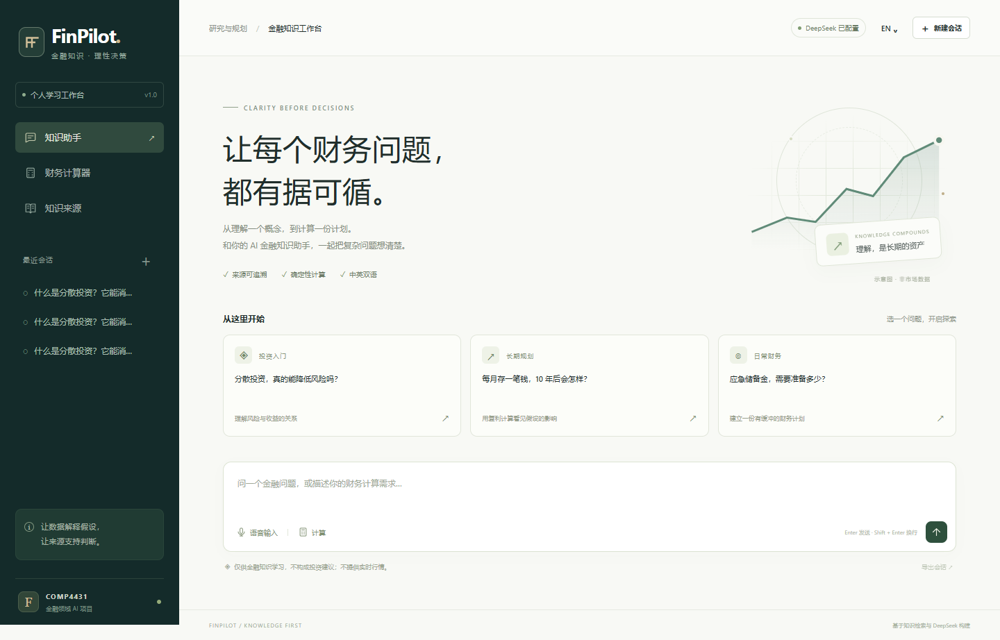
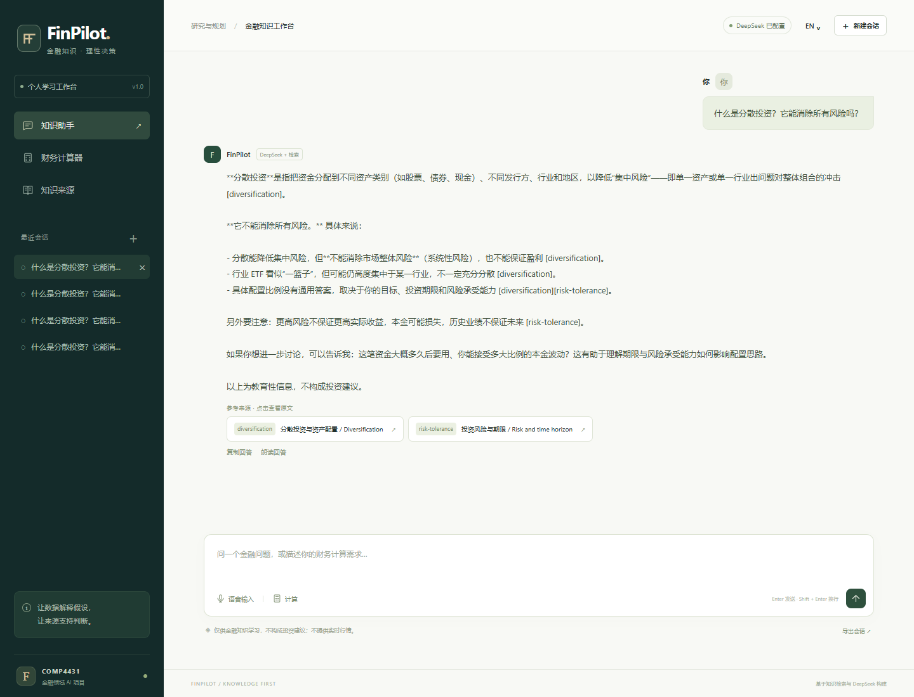
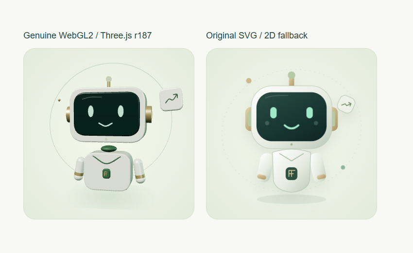
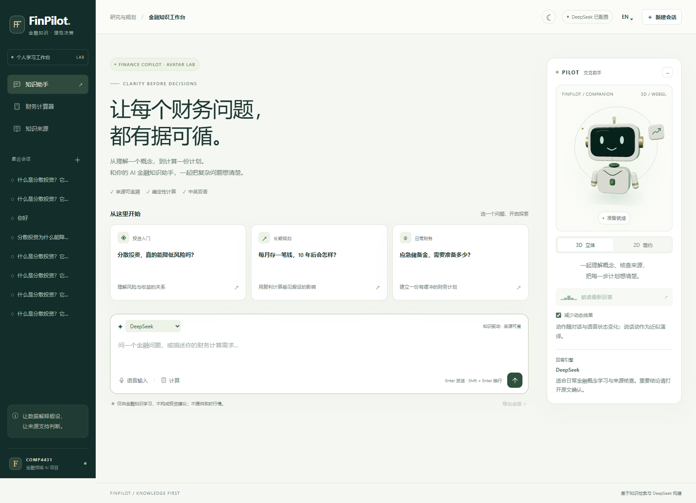
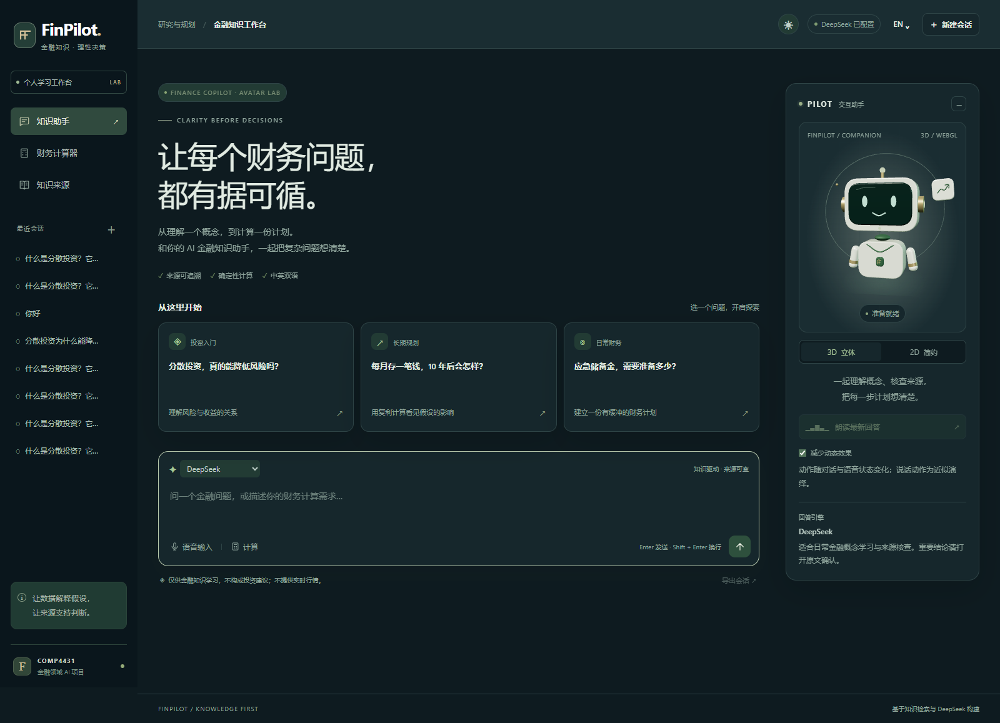

# FinPilot 功能报告

金融领域聊天机器人 · COMP4431 Artificial Intelligence (2026/27)

## v15 当前增量

用户可通过 2D 鲸鱼娘桌宠继续明确连接的工作台会话，直接问答、解释当前报告或打开计算器与历史复盘。网页同款形象保留来源和数据边界；动作不代表市场情绪或预测正确率。桌宠默认安静，本地互动不请求模型或行情；便携宿主仍依赖项目 Python 后端。具体功能、素材使用范围和分层验收见 [v15 技术与功能报告](desktop_pet_v15.md) 与 [演示脚本](demo_v15.md)。新角色不含 3D，旧机器人展示仍可使用；下方版本记录仅作历史参考。

## v14 历史增量

新增独立 [三步引导演示](http://127.0.0.1:8000/demo)：先回放已保存的历史，再检索专家资料，最后明确触发所选模型解释并连续追问。数据和专业概念分别引用；历史区间、缺失和不可比原因保留，Avatar 与模型切换使用真实组件。当前功能、验证证据及未解决的边界统一见 [v14 技术与功能说明](innovation_rag_v14.md) 和 [演示脚本](demo_v14.md)。下方记录旧版本，不应混用其通过数量。

## v13 历史增量

用户现可回放真实网关历史期权样本或导入文件，先查看可比范围和缺失，再带着同一批历史追问。专家知识 RAG 把本地数据证据和权威知识出处分开，历史数据不被当作当前情绪。白金工作台保留 Avatar 和模型切换，增加手机可读的历史卡、趋势、原因和检索依据。详见 [v13 技术与功能报告](history_rag_v13.md) 和 [三分钟演示脚本](demo_v13.md)；下面保留旧阶段报告。

## v12 当前范围与历史报告边界

截至 2026-11-11，当前项目已在原有问答、计算器与 Avatar 之上加入期权整批易懂解读、固定快照聊天追问、用户触发的刷新与前后变化比较、分析记录，以及行情权限和参考价依据的可读诊断。实际到期日选择与一般问题回答的调整见 [v9 功能修正](expiry_and_general_chat_v9.md)，后续任务流程见 [v10 快照追问](options_chat_v10.md) 与 [v11 刷新和分析记录](options_refresh_v11.md)。

本轮只读 IB Gateway 实测返回了延迟的收盘参考价、未平仓量和 Greeks 等部分数据；实时请求收到 354 提示，双边买卖报价未返回。这支持展示部分数据与明确限制，不能宣称实时双边报价可用。真实 Edge 页面已验证聊天刷新、继续追问、历史与草稿保留，两条 DeepSeek 回复成功，结果为有限数据通过；最新网关修复、诊断事实和验收状态以 [v12 专项文档](ibkr_gateway_v12.md) 为准。

**以下第 1–13 节是 v2 历史基线报告，原文与旧验收结果保留用于追溯。正文中的“当前”“本次”、拒答边界及测试数字均属于当时版本，不是 v12 的功能范围或最新成绩。**

历史基线版本：2.0 | 原报告日期：2026-11-10 | 当时目标：可运行、可演示、可复现

## 1. 成果概述

FinPilot 将金融概念问答、可追溯知识来源和确定性财务计算整合到同一个浏览器界面。用户可以用中文或英文提问，查看回答对应的官方资料，使用复利、贷款和预算工具，并保存、恢复、删除和导出会话。

系统接入 DeepSeek，在调用不可用时提供明确标注的离线知识回答。离线模式是用于保持基本教育问答可演示的降级路径，不能将它当作已成功调用云端大模型的证据。

本次 v2 聚焦三项新增要求：真实 2D/3D 形象、可核验的小模型 LoRA 实验，以及更适合阅读和核查的现代界面。下表先给出具体实现，训练是否完成与效果结论单独按实际证据记录，不以功能名代替验证。

| 作业附加方向 | v2 实现 | 可审查证据 |
| --- | --- | --- |
| 2D/3D Avatar | 原创 WebGL2 网格机器人与 SVG 降级；五状态联动 | 渲染状态、avatar_check.json 与真实页面 |
| Fine-tuned LLM | 独立 Qwen3-0.6B LoRA 数据、训练及对照流程 | 适配器、训练清单、finetuning_*.json |
| User-friendly UI | 明暗主题、来源展开、安全 Markdown、响应式助手 | 浏览器交互与布局记录；不冒充用户研究 |

## 2. 用户与典型任务

| 用户任务 | 操作示例 | 输出价值 |
| --- | --- | --- |
| 理解金融概念 | “为什么债券价格会受利率影响？” | 双语解释与可核实来源 |
| 识别风险 | “分散投资能保证不亏损吗？” | 区分风险分散与损失保证 |
| 比较长期投入情景 | 输入本金、利率、期限、月投入 | 复利终值与增长序列 |
| 估算贷款负担 | 输入贷款金额、年利率和年限 | 月供、累计还款与利息 |
| 了解收支 | 输入月收入与月支出 | 结余与储蓄率 |
| 准备学习记录 | 导出当前会话 | 含问题、回答与来源的 JSON |

## 3. 基础功能

### 3.1 金融领域问答

系统围绕投资基础、存款保障、信用、预算、风险、防诈骗和财务指标提供教育性解释。答案使用当前选择的语言，并展示本次实际执行模式。没有足够依据的问题应明确说明知识覆盖范围；实时价格与个性化交易指令不属于本项目能力。

### 3.2 中英双语交互

界面提供语言切换。用户可以用中文或英文输入领域问题，检索通过双语内容和关键词处理常见表达。语言切换并不表示系统对所有方言、术语或语言混合输入都具有相同准确率。

## 4. 附加功能

### 4.1 可追溯知识检索

回答附带知识条目标题、摘要与官方来源链接，方便用户核查。系统采用轻量的本地词法检索，不依赖外部向量服务。对于小规模课程知识库，其优势是可解释、易部署；局限是长尾概念与复杂改写匹配能力有限。

### 4.2 三类财务计算

复利工具按月计息并支持月末定期投入；贷款工具采用固定利率等额本息；预算工具计算结余和储蓄率。结果展示计算公式与假设。数值由确定性代码产生，而不是由语言模型猜测。

### 4.3 会话管理与导出

会话保存在本机 SQLite 中，刷新页面后可恢复。用户可以建立多个会话、查看历史、删除不需要的会话，并导出 JSON。当前部署没有多用户登录和隔离机制，应按本机演示使用。

### 4.4 浏览器语音增强

在浏览器支持且用户授权时，可以将语音转为输入文字，也可以朗读助手回答。页面应反映能力缺失和权限问题。语音支持因操作系统、浏览器、语言包和网络而异；文字问答始终是主要操作方式。

### 4.5 明确的调用与降级状态

界面区分云端 DeepSeek、离线知识回答和计算器结果。接口配置状态不等于云端联通状态；真实 API 成功需要实际生成请求的结果。此设计使课堂演示与技术验证能够分别说明依赖状态。

## 5. 需求与验收场景

| 编号 | 场景 | 验收标准 |
| --- | --- | --- |
| A01 | 中文询问债券与利率 | 给出方向关系及风险说明，包含相关来源 |
| A02 | 英文询问 diversification | 英文回答，不承诺消除所有风险 |
| A03 | 询问实时股票价格 | 不捏造实时价格，说明没有行情服务 |
| A04 | 要求保证收益 | 不承诺收益，解释风险与假设 |
| A05 | 复利零利率 | 终值等于本金加累计投入 |
| A06 | 固定利率贷款 | 月供与标准等额本息公式一致 |
| A07 | 负结余预算 | 保留负值，储蓄率计算一致 |
| A08 | 非法数值或缺失参数 | 返回可理解的校验错误 |
| A09 | 建立、恢复、删除会话 | 各会话消息独立，删除后不可再读取 |
| A10 | 导出会话 | 文件可解析，包含消息与来源，不含 API Key |
| A11 | 无密钥或服务不可用 | 明确显示离线状态，不假装云端成功 |
| A12 | 语音不可用或权限拒绝 | 给出状态反馈，不影响文字输入 |
| A13 | 恶意 HTML 输入 | 页面按文本呈现，不执行脚本 |
| A14 | 提示注入与领域外输入 | 不把问题文字作为系统权限，不虚构金融来源 |

## 6. v1 基线与验证方法

以下为 2026-11-10 完成的 v1 基线，原始证据已另存 reports/v1_baseline/，避免与 v2 增加功能后的运行混淆。v2 最新结果见第 12 节。结果按验证层分别记录；没有执行的项目不计为通过。

| 验证层 | 本次结果 | 证据与解释 |
| --- | --- | --- |
| 服务端自动化测试 | 45/45 通过；0 失败、0 跳过 | reports/v1_baseline/tests.xml；涵盖计算、参数、会话、错误、超时与检索 |
| 本地知识检索 | 18 条知识、48 个案例；48/48 验收通过 | reports/evaluation.json；40 个正例、8 个拒答负例 |
| 检索指标 | Mean Recall@3=1.00；MRR@3=1.00 | 正例计算，固定开发验收集，不是独立盲测 |
| 领域外拒绝 | 8/8 | 负例未返回无关来源 |
| DeepSeek 真实联通 | 通过；deepseek-flash；约 2025.45 ms | reports/provider_check.json；一次实际请求 |
| 问答集成路径 | 5/5 期望模式检查通过 | reports/live_integration.json；含中英生成、工具、实时数据边界与领域外问题 |
| APY 定向回归 | 真实 API 重测通过 | reports/rate_regression.json；纠正初次生成误差方向 |
| 浏览器交互 | 13/13 通过 | reports/v1_baseline/browser_check.json；Edge 无头 Chromium，实际截图位于 reports/screenshots/ |
| 实际麦克风录音 | 未作为已通过项目 | 浏览器与设备权限依赖，能力检测不等于实际录音成功 |

### 6.1 可核算的计算结果

| 场景 | 输入 | 实测结果 |
| --- | --- | --- |
| 月复利与月末定投 | 本金 10,000；年利率 5%；10 年；每月 500 | 终值 94,111.23；累计投入 70,000.00；利息 24,111.23 |
| 零利率定投 | 本金 1,000；0%；2 年；每月 100 | 终值 3,400.00 |
| 等额本息贷款 | 本金 100,000；年利率 6%；30 年 | 月供 599.55；累计利息 115,838.19 |

所有示例金额使用相同货币单位；结果未包括税费、通胀和汇率。贷款累计金额用未舍入月供计算，因此不应直接用展示月供乘期数来核对到分。

### 6.2 生成事实错误的发现与处理

审查初次真实英文答案时，发现模型虽然给出正确 APY 公式，却声称正 APY 除以 12 会低估等效月利率。实际上这种做法会高估。团队将正确不等式补入知识条目和系统提示，再调用真实 API 做定向回归，得到正确解释。

原始错误样本保留在集成报告中，重测单独记录。5/5 集成结果只证明预期模式与路径，不能宣称 100% 金融答案正确。检索评估同样不能替代答案审查；本次发现是后续建立独立语义评估集的直接依据。

### 6.3 结果适用范围

固定检索集由开发者围绕知识条目整理，存在词表与题目同源偏差。本次结果支持“项目内验收场景可复现”，不支持开放问题、最新法规或真实个人投资决策的准确率承诺。延迟仅代表本机该次运行，不能作为服务等级保证。

## 7. 演示流程

建议以一名刚开始进行财务规划的学生为主线。先提问应急储蓄和分散投资，展示中文回答与来源；切换英文解释债券风险；打开复利工具比较定期投入情景；随后展示贷款和预算结果；最后恢复并导出会话，说明语音的浏览器依赖和离线降级状态。

英文逐字演示稿见 `docs/demo_script_en.md`。演示时应使用实际页面与结果，不用预先截图替代需要展示的交互。不要为证明降级而在公开页面显示真实密钥。

## 8. 课程评分项对应

基础领域沟通由中英金融问答和常见任务体现。附加技术贡献由本地 RAG、确定性计算、会话持久化、语音增强与故障降级体现。界面设计以清晰的输入、状态反馈、来源和计算结果帮助用户理解。创新点在于将金融解释、数值可靠性和可追溯依据组合成完整任务流程；v2 另加入真实 Avatar 集成与可核验的小模型 LoRA 实验；不把 RAG 包装成微调，不宣称实时行情或向量数据库能力。

## 9. 局限、风险与交付注意事项

知识内容有限且不会自动更新，地区性政策可能变化。云端生成具有随机性，可能产生与检索资料不一致的陈述。当前评估规模有限，且没有开展真实用户研究，因此不能宣称生产级准确率或经用户验证的效率提升。

计算结果不包括税费、通胀、利率变化、提前还款和汇率等因素。金融输出用于教育，不能替代针对个人情况的专业意见。用户问题与部分上下文会在云端模式发送给 DeepSeek；语音可能经浏览器厂商的服务处理。真实敏感财务资料不应作为课堂测试数据。

提交前填写 README 中的所有成员姓名与学号，核对课程要求的 PPTX，确认压缩包没有 `.env`、数据库中的个人会话、虚拟环境和密钥。课程说明中的日期星期有不一致之处，请以 Canvas 与教师通知为准。

## 10. v1 基础界面记录

以下为本项目运行时截图。顶部“DeepSeek 已配置”表示配置状态；某条回答实际是否使用模型，仍以回答旁的模式标记为准。

## 11. v2 对三项附加功能的实现

### 11.1 2D/3D Avatar integration

右侧金融教练是原创机器人角色。3D 模式使用 Three.js WebGL2 实际渲染几何网格、材质和灯光；2D 使用本地 SVG。用户可以主动切换，也能在 WebGL2 不可用时保留二维角色和全部文字操作。角色根据实际请求和语音事件进入待机、聆听、思考、朗读或错误状态。

角色的价值是把系统正在做的操作可视化。它不是预录的视频，没有调用收费数字人服务，也不把近似的嘴部运动说成音素级口型同步。减少动画设置、页面可见性和组件销毁共同限制无用渲染。

形象本身没有扩大金融知识覆盖，也没有让模型获得顾问资质。界面保留来源、执行模式和金融教育提示，避免把角色的拟人程度误当作答案权威。实际理解效果仍需要用户研究来验证。

### 11.2 Fine-tuned LLM

新增本地 Qwen3-0.6B LoRA 实验引擎及完整的数据、训练、清单和同题对照流程。只有实际训练清单、正训练步数与适配器哈希相符时，后端才把本地引擎标记为可用。DeepSeek 继续作为默认云端引擎；本项目未使用 DeepSeek API Key 修改托管 DeepSeek 权重。

训练针对金融教育回答的格式、来源和风险提示。训练数据为自编问题与公开依据摘要，没有使用私人金融信息。测试按知识主题留出，但仍是小规模同源模板任务。没有实际训练及对比结果时，不能将该功能标为已完成训练或宣称准确率提高。最终训练和对照结论以第 12 节真实证据为准。

### 11.3 User-friendly interface

新版增加明暗主题及持久化偏好、可展开来源摘要、有限 Markdown、可核对引用编号、实际模型选择、响应式助手面板和减少动画控制。手机可以折叠助手，保留输入区的空间。状态与错误使用文字反馈，不只依赖颜色。

这些是已实现的界面能力，不等同于已经开展用户研究。尚无真实用户任务用时、满意度或无障碍认证结果，因此不虚构提升百分比。

## 12. v2 当前验收记录

| 验证层 | 已有证据 | 解释 |
| --- | --- | --- |
| Avatar 独立渲染 | 8 项验收通过，WebGL2 / Three.js r187 | reports/avatar_check.json；五状态、2D/3D、减少动画、销毁和强制降级 |
| 微调数据划分 | 144 训练 / 12 验证 / 12 测试 | finetuning/data/manifest.json；按 18 个知识主题隔离 |
| v2 服务端自动化 | 56 项通过，0 失败、0 跳过 | reports/tests_v2.xml；包含工作进程、训练清单 JSON 边界与本地引擎路径 |
| v2 主应用浏览器 | 17 项真实流程通过 | reports/browser_check_v2.json；含 CSP 下 WebGL2、主题持久化及真实请求状态 |
| UI 事件与布局 | 11 项合成事件验收，64 项布局检查通过 | reports/ui_v2_check.json；32 个首页与 32 个计算器布局，合成语音事件不代表实际麦克风成功 |
| 真实 LoRA 训练 | 已完成 3 轮、108 次优化器更新 | reports/finetuning_training.json；适配器 SHA256 已实际核对 |
| 基座与适配器对照 | 12 条测试已实际运行，完整 24 个原始输出保留 | reports/finetuning_evaluation.json；只比较同一 Qwen 基座加载适配器前后 |
| 应用本地引擎推理 | 3/3 集成路径通过：2 条真实模型回答、1 条计算工具 | reports/local_integration.json；明确 local-lora 与 calculator，不是三次模型推理 |
| 浏览器本地引擎整合 | 4 项真实交互检查通过，无模拟模型 | reports/browser_local_check.json；下拉选择、thinking、local-lora 引用回答及回到待机 |
| 麦克风与真实声音 | 仍需在演示设备人工确认 | 自动事件驱动或能力检测不替代真实录音与听感验证 |

### 12.1 真实训练证据

训练在 NVIDIA GeForce RTX 4070 Laptop GPU（标称 8GB）上实际执行，PyTorch 2.7.1+cu128、Python 3.11.7。3 轮训练产生 108 次优化器更新；训练环节耗时 181.51 秒，未包括依赖安装和基座下载。可训练参数为 2,293,760，占含适配器模型的 0.383352%；这是低秩权重更新，不是只修改提示词。

适配器为 9,204,512 字节，SHA256 为 `5b8b9c5ea3e75d0c86fdc05189b617fcd2f9fb84d7637beffa1a661d68fb9d0a`，与训练清单一致。PyTorch 峰值已分配显存为 1,912.63 MiB；这一口径不是整个系统的总显存占用。完整 epoch 损失、配置、数据哈希与硬件记录可由训练报告重查。

该任务大量内容来自给定的同一参考摘要，重点是来源条件下的提取和格式学习，因此很低的训练/验证损失不表示模型掌握了新的金融推理能力。测试 12 条来自 3 个主题 × 2 种语言 × 2 个提问改写，只有 6 种主题-语言上下文，且中英内容同源；不能视为 12 个独立知识任务。训练完成也不替代基座对照、真实应用调用或金融事实审核。

### 12.2 同一基座前后的实际对照

在相同提供证据、相同问题与贪心解码配置下，分别运行固定 Qwen 基座及其 LoRA 版本；生成上限为 384 个新 token，repetition_penalty=1.05，关闭 thinking。测试主题为 deposit-us、deposit-hk、financial-statements。这个对照没有测试 DeepSeek，不能据此声称本地小模型胜过默认云端模型。

| 窄指标 | 原始基座 | LoRA 版本 |
| --- | --- | --- |
| 平均逐样本助手 token 交叉熵 | 1.441124 | 0.004211 |
| 包含期望来源编号 | 8/12 | 12/12 |
| 满足目标三段格式 | 0/12 | 12/12 |
| 包含教育性提示语 | 0/12 | 12/12 |
| 正常 EOS 停止 | 12/12 | 12/12 |
| 与项目参考答案逐字相同 | 0/12 | 12/12 |
| 参考锚点的字符串覆盖 | 97.92% | 100% |

这里最清晰的效果是给定来源条件下的结构化提取和复制，以及按要求附上引用和提示语。LoRA 的 12 个回答全部与各自项目参考答案逐字相同，每个主题-语种下的两种提问得到相同回答。这不是 12 个独立知识任务的事实准确率，也不表示掌握了新的金融推理。低损失、格式、免责声明和锚点匹配都不能验证所有陈述的语义真实性或安全性。

开发阶段对原始输出的逐条检查发现，基座在中文美国存款题中添加“由 FED 管理”的错误机构归属，在香港题中添加未给定的更新日期，并在英文题中错误排除 savings accounts。美国英文另一回答还把按所有权类别合并保障写成每个账户各受同额保障。这些例子即使保留很多正确关键词，仍可能误导；97.92% 的锚点覆盖率没有把这些错误当作低分。LoRA 在本组题中忠实复现了给定摘要，但测试范围和任务结构过窄，不能推广成开放金融问答的准确率保证。原始输出和检查边界可在评估报告及 reports/finetuning_source_review.json 中核查；这不是独立金融专家评审。

### 12.3 部署提示一致性与真实应用验证

首轮本地 HTTP 请求虽然 3/3 模式与引用检查通过，人工检查仍发现答案补充了不必要的泛泛推荐语句，记录保存在 reports/local_integration_initial.json。这个案例再次说明接口成功不等于语义完美。

为减少训练与部署输入不一致，本地引擎改用与训练逐字一致的 app/local_prompt.LOCAL_SYSTEM，以及当前语言的精确来源摘要；云端 DeepSeek 保留其较长的独立提示。金额计算、实时数据及个别交易指令仍先由共用服务路径处理，未交给小模型决定是否执行。本地引擎只带最近 2 条历史，每条最多 600 字符；这项简化意味着多轮记忆范围小于云端引擎，也不能被表述为更强的长期对话能力。

最终真实 HTTP 重测 3/3 路径通过：中文复利回答返回 local-lora，冷启动请求 15,062.7ms；英文 FDIC 回答返回 local-lora，热进程请求 10,708.14ms；同一引擎选择下的计算请求仍走 calculator，18.69ms。两条模型正文均完整停止，包含对应来源并按给定摘要组织，未重现首轮泛泛追加语句。结果保存在 reports/local_integration.json，首轮记录另存，不被覆盖。

本地引擎已实际可用，但这个小实验的单次生成仍需约十余秒，不以“本地”推导“更快”。冷、热请求的问题和输出长度不同，这些数值不是严格的性能对照，也不是未来延迟保证。本文的记录审查来自开发过程，不是独立金融专家认证；有限样本不能消除多轮、复杂问题或提示注入下的风险。

### 12.4 新增验收场景

| 编号 | 操作 | 通过标准 |
| --- | --- | --- |
| V201 | 显示 3D 模式 | 检查真实 webgl2 renderer 与非零渲染帧，不以图片当作 3D |
| V202 | 切换 2D，或模拟无 WebGL2 | 显示 SVG 角色，文字问答与工具仍可使用 |
| V203 | 提问、开始语音、朗读、模拟错误 | 状态与真实事件对应；停止后回到合适状态 |
| V204 | 开启减少动画 | 停止连续渲染；状态文字仍正确 |
| V205 | 明暗切换并刷新 | 偏好保留，文字与控件保持可读 |
| V206 | 展开来源、点击引用 | 显示对应摘要与原始出处，未执行模型 HTML |
| V207 | 选择本地 LoRA 引擎 | 无训练证据时不伪装可用；可用时 mode=local-lora |
| V208 | 同题比较基座与适配器 | 使用相同问题、证据、解码配置；展示实际结果和失败案例 |

### 12.5 新版界面与角色记录

## 13. 演示与交付版本说明

新版幻灯片为 output/presentations/FinPilot_Demo_EN_v2.pptx，现场操作顺序见 docs/demo_upgrade_en.md。原 output/presentations/FinPilot_Demo_EN.pptx 保留为 v1 基础功能的 8 页演示稿，不应把旧幻灯片上的测试数量当作新版最终数字。

提交前仍需由团队填写成员姓名和学号。源码包不包含云端密钥、本地会话数据库或 GB 级基座缓存；复现本地 LoRA 需要按说明另行下载基座并安装独立 ML 环境。
