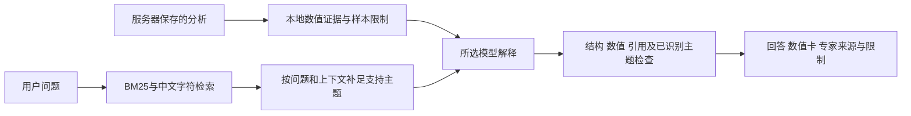

# v14：可核查的期权解释、专家 RAG 与引导演示

v14 把“查看历史数据、理解专业概念、向模型追问”连接成一条可检查的流程。核心改进是区分本地数据依据与专家概念依据，并检查已识别的知识主张是否引用了支持该主题的资料。它没有训练新的大模型，也没有新增 embedding 或向量数据库。

本文以 2026-11-11 的代码和报告为依据，保留 [v13 实现记录](history_rag_v13.md)。**v14 真实模型验收为有限数据通过**：原快照一轮、独立演示两轮均通过最终校验；使用已存历史，不是新行情验证。离线、受控浏览器与真实云模型结果分别记录。

## 1. 功能与数据流

入口 `/demo` 提供三步引导：“一份历史档案 → 一组专家依据 → 可核查的 AI 解释”。完整工作台位于 `/workspace`，历史视图位于 `/workspace?view=history`。原期权快照聊天和历史聊天共用专家知识库与有界引用检查，保留各自的数据类型和时间约束。



| 能力 | 具体行为 | 边界 |
| --- | --- | --- |
| 原期权快照问答 | 读取服务器保存的分析、时间、实际行情类型、质量及已有前后比较；补充有关成交、持仓、定价或报价的专家资料 | 模型不自行重新采集行情，旧快照不因新回答被覆盖 |
| 历史问答 | 读取固定共同样本、历史区间、逐合约末值及缺失/不可比原因；结合专业资料解释 | 历史不能代表此刻行情；缺失 OI、BBO 或合约历史 IV 不补造 |
| 专家来源检查 | 对段落中规则能够识别的金融知识主张，核对引用来源的 `supports` | 属于有界规则检查，不是任意语言的语义蕴含证明 |
| 独立引导演示 | 回放本地真实存档、展示候选来源，再由用户明确发送模型问题；使用独立演示会话 | 不读取已有聊天；载入档案仍会建立一份新的本地分析记录 |
| Avatar 与模型切换 | Three.js 3D / SVG 2D、实际渲染模式或降级提示；选择状态接口标明可用的回答引擎 | 动作表示交互状态，不代表判断置信度；切换模型不重新采集行情 |

## 2. 14 个有审阅范围的知识块

知识库文件为 `data/expert_knowledge.json`，版本 `1.1`，本轮审阅日期为 2026-11-11。来源包括 OCC/OIC、Cboe 和 IBKR 官方资料。每条资料保留 ID、中文/英文摘要、发布方、原文链接、审阅日期、主题和 `supports`；`source_review` 另行区分官方直接支持、项目分析推论和不可推广的边界。

| 知识块 | `supports` | 可支持的主要主题 |
| --- | --- | --- |
| `expert.volume_oi` | `volume_vs_oi` | 成交计数与未平仓量的区别 |
| `expert.put_call` | `put_call_limits` | 看跌/看涨计数不能直接解释为人数或多数观点 |
| `expert.oi_cycle` | `oi_reporting_cycle` | OI 隔夜核对、独立统计日期 |
| `expert.volatility` | `iv_direction_limits` | 波动幅度与涨跌方向的区别 |
| `expert.pricing` | `option_price_factors` | 权利金的多种影响因素 |
| `expert.spread` | `bid_ask_execution` | 报价、订单和可成交性的区别 |
| `expert.history_permissions` | `historical_permissions` | 历史接口权限与返回字段核对 |
| `expert.history_limits` | `expired_eod_limits` | 已到期期权及原生 EOD 限制 |
| `expert.history_volume` | `historical_volume_filtering` | 历史成交过滤与累计口径 |
| `expert.history_bars` | `historical_bar_semantics` | 历史 OHLC / BID_ASK 条不等于同步可执行报价 |
| `expert.history_time` | `historical_time_basis` | 交易区间、导入时间与当前行情的区别 |
| `expert.history_iv` | `historical_contract_iv_limits` | 标的历史 IV 不等于逐合约历史 IV / Greeks |
| `expert.contract_identity` | `contract_comparability` | 合约身份与共同样本比较 |
| `expert.history_oi` | `historical_oi_availability` | 当前 `reqHistoricalData` 成交条没有按日期返回 OI 的类型 |

几个需要明确的出处边界：

- [Cboe 的提前行权交易案例](https://www.cboe.com/insights/posts/how-early-exercise-order-flow-impacts-equity-option-put-call-ratios)直接说明某些看跌看涨比率尖峰可以不含方向信息。“合约计数不是独立人数投票”是结合计数单位得到的分析推论，不能反过来断定本次样本一定在对冲或提前行权。
- [IBKR 历史 bars 定义](https://www.interactivebrokers.com/docs/tws-api/doc/md/historical-bars)分别定义 TRADES、BID_ASK 和历史 IV 类型。BID_ASK 的平均值与区间极值不能拼成同一瞬间的可成交报价；这一主题由独立知识块支持，不再借用“已到期期权限制”的出处。
- 历史 OI 条目的范围仅是上述历史 bars 接口；[流式数据接口](https://www.interactivebrokers.com/docs/tws-api/doc/md/streaming-data)另有 OI 字段，不能据此声称所有 IBKR 接口或第三方都没有历史 OI。
- “缺失不能补零”是本项目的数据处理约束。来源链接不能为缺失的市场字段提供数值，也不能证明用户导入文件真实。

## 3. 检索、主题补足与引用检查

`app/expert_knowledge.py` 保留词法检索：BM25 词项排名与中文二元/三元字符排名独立计算，再由 RRF 合并。v14 增加一般英语形态归一、领域短语归一和明确非金融上下文消歧。它们改善了部分同义表达，仍不能覆盖任意自然语言。

`app/expert_grounding.py` 在聊天生成前进行第二层选择：

1. 先取得问题的真实词法检索结果。
2. 识别问题明确要求的知识主题，并读取已保存分析的上下文约束，例如历史区间、报价不足或持仓统计日期。
3. 优先采用已有结果中支持该主题的资料；确有需要时，从审阅语料中补足相应主题，最多保留六条。
4. 保留选择原因：`lexical_rank`、`query_facet` 或 `context_facet`。若补入条目没有自然检索排名，BM25、字符排名和 RRF 分数为 `null`，不虚构“高分命中”。

模型返回后，逐段检查已识别的知识主题与所引用 `expert.*` 条目的 `supports`。未知 ID、当前生成上下文没有提供的专家来源、识别出的主题缺少支持或附加了无关专家引用，都会触发拒绝或有界格式修正。数据复盘还须保留本地证据，专家原则不能替代样本观察。

本地数值与专家依据分开保存：历史数值 ID 使用 `h.*`，原快照使用其本地分组证据，刷新比较使用 `change.*`，专家概念使用 `expert.*`。回答上下文保留分析身份、来源、时间、引用、检索信息和主题检查结果；新问题不改写旧回答。

格式或已识别依据检查失败时，模型阶段最多进行一次基于原上下文的修正，合计时限六十秒；网络失败不因此自动反复调用。最终应按返回的 `mode`、`warning` 和生成次数展示事实，不能将本地降级回答写成云模型验收通过。

修正请求包含逐段 `citation_repairs`：缺少的主题、原上下文中可用的对应来源、应删除的无关引用及无法修复的问题。计划只给模型明确提示，不自动向答案粘贴来源，也不添加新数值或知识主张。修正结果仍须完整重新验证。原快照仅在问题确实涉及变化时向模型提供已有前后比较；“不要更新行情”不会误触发比较上下文，完整历史始终保留。

**能力边界：**主题识别使用有限词法和规则；未识别的复杂改写、因果暗示、遗漏条件或新主题仍可能逃过检查。`supports` 是人工审阅的允许范围，不是逐句语义证明。候选资料、生成时检索到的资料、回答实际引用的资料也不是同一集合，界面分别呈现。

## 4. 演示所用真实存档与零新增采集

`/demo` 的“载入真实历史档案”调用本地 `POST /api/options/history/sample`，读取项目已有存档、重新运行本地分析并保存新分析 ID。它不连接 IB Gateway、不请求当前行情、不调用模型。页面初始只检查可用模型状态；本地专家检索也不生成模型回答。

存档来自 2026-11-11 的一次实际网关探测：AAPL 股票，以及 **2026-11-13 到期、行权价 350 的看涨/看跌各一份合约**；查询已结束的五个纽约日历日，返回 2026-11-06、09、10 三个交易日期。请求为盘中一小时 TRADES bars，再按纽约日期汇总，标为 `derived_from_intraday_trades`，不是原生 EOD。

| 交易日期 | 看涨已收 bar 数 | 看跌已收 bar 数 | 看涨已收成交计数 | 看跌已收成交计数 |
| --- | ---: | ---: | ---: | ---: |
| 2026-11-06 | 8 | 9 | 6509 | 877 |
| 2026-11-09 | 11 | 8 | 8047 | 3982 |
| 2026-11-10 | 11 | 11 | 9441 | 3394 |

这些计数是已返回 bars 的合计，不保证覆盖完整交易时段。程序保留样本值，但对覆盖未核验的成交计数及占比不生成跨日变化结论，原因是 `historical_bar_coverage_unverified`。同一份合约的末值比较指所收成交记录的末值，不是官方收盘或结算价。

该历史样本没有 OI / 独立 OI 统计日期，没有同步正双边 BBO，也没有逐合约历史 IV / Greeks。缺失保持为空，不填成零；历史成交末值不升级为当前可执行报价。真实网关来源可追溯，仅证明由所配置网关返回，未独立完成交易所数据校准或完整时段核验。合约到期后仍可回放本地存档，不应继续向 IBKR 请求这份已到期合约。

## 5. 面向非专业用户的完整体验

演示页沿用浅底、深色文字、克制金色强调和半透明卡片。首屏用三步导航说明“数据是什么、依据在哪里、何时请求模型”，逐步开放后续操作。桌面侧栏和移动端布局采用同一操作顺序。

Avatar 使用实际 Three.js 程序生成的 3D 形象及 SVG 2D 形象；可键盘切换，3D 不可用时说明真实降级状态，并支持减少动态。表情和动作仅表示等待、处理、回答或出错，不是情绪判断正确率；程序口部动画也不是音素级唇形同步。

模型列表来自 `/api/models` 的可用状态，只有用户明确发送才请求所选引擎。无可用模型时仍可查看档案和检索资料。请求失败保留输入草稿与已载入数据；发送锁避免重复提交。每条回答各自显示数值依据、专家来源和限制，候选资料预览不冒充最终引用。通用问题仍走相应问答路径，不强行附加虚构历史证据。

这轮创新点在于**数据比较约束、可审阅的专业概念范围和渐进式解释体验的组合**，不是把成熟 BM25/RRF 算法包装为新的训练成果。普通用户能够先看到可确认事实，再理解为什么部分结论不能成立。

## 6. 检索评估与验收状态

检索报告只评估原始 `ExpertKnowledge.search` 的召回和排序，不包含聊天的主题补足、模型回答或逐段引用检查。每个报告记录语料、查询集及检索器 SHA256；不能把这些指标称为答案准确率。

| 集合 | 相关 / 无关问题 | Recall@4 | MRR@4 | 全部所需来源齐全 | 无关问题正确弃答 |
| --- | --- | ---: | ---: | --- | --- |
| 初次基线，后改称开发集 | 32 / 8 | 84.38% | 0.804688 | 27/32 | 4/8 |
| 规范化后的开发集 | 32 / 8 | 96.88% | 0.932292 | 31/32 | 7/8 |
| 算法冻结后首次运行的 blind holdout | 18 / 6 | 87.04% | 0.796296 | 15/18 | 4/6 |

原 40 例暴露结果后参与问题发现，不能继续称为未见测试。另由评估代理编写 24 例，中英各十二例，包含四条跨主题题目；先向算法作者提供数量与哈希，冻结算法后才评分，具体问题未用于此次调参。该集合仍是同团队人工标注的小样本，不是第三方盲测。原始基线查询有逐字节副本，原报告没有被覆盖。

独立集合仍有三条相关问题没有取齐所需来源、两条无关问题被误召回；跨主题题目仅三条完整取齐。失败均保留，未改标签或以补足规则后的结果替换原始检索分数。

| 验证层 | 当前事实 |
| --- | --- |
| 服务端离线检查 | `tests_v14.xml`：649 项通过；另有一条依赖弃用提醒 |
| `/demo` 浏览器检查 | 27 项检查在 320、390、1440 视口通过；API 受控，Avatar 为实际本地渲染；这是响应式仿真，不是真机测试 |
| 既有 v13 真实历史流程 | `passed_limited`；真实网关采集、实际 Edge 和两轮 DeepSeek 曾完成，但有出处对齐局限，不自动升级成 v14 结果 |
| v14 原快照专家 RAG 云端验收 | `passed_limited`；已有真实 IBKR 快照、一轮实际 DeepSeek、两次生成含一次引用修正；零新行情请求、零会话修改 |
| v14 `/demo` 真实云端连续问答 | `passed_limited`；实际 Edge、一次存档回放、一次专家检索、两轮 DeepSeek，共四次生成含两次修正；数据/来源/时间/持久化及导出通过；零新 IB 请求 |

最终三条真实回答都经过一次修正，不能声称首答全部正确。人工复核确认：所收看涨末值上升、看跌末值下降及标的末值上升与本地证据一致；未把覆盖不齐的成交变化或缺失 OI 当作可比变化，未把历史样本解释成当前市场情绪。第二轮将历史 OI 的限制限定于本次成交条接口，不推广为所有来源均不可用。个别措辞仍可改进，例如“标的为所选到期合约”不够精确，准确身份以合约卡片为准。

开发验证并非首次全部通过：保留六次原快照失败、一次引导演示引用失败和两次零模型的脚本预检失败。已记录的 v14 模型生成尝试共二十次（含失败与修正），其中最终通过运行占六次；这不是账单费用或普遍准确率。[完整验证审计](../reports/innovation_acceptance_v14.json) 逐项记录。旧报告不改写为成功。

## 7. 复现与证据

不调用网关或云模型的检索复现命令如下。它们写新的评估报告，不应覆盖原始基线；已暴露的 holdout 后续重跑也不能再宣称首次未见评估。

```powershell
.\.venv\Scripts\python.exe scripts/evaluate_expert_v14.py --cases evaluation/expert_cases_v14.json --out reports/expert_retrieval_dev_v14.json
.\.venv\Scripts\python.exe scripts/evaluate_expert_v14.py --cases evaluation/expert_holdout_v14.json --out reports/expert_retrieval_holdout_v14.json
```

方法参考已通过只读 Undermind 元数据/摘要和 GitHub 源码核对：[BM25](https://doi.org/10.1561/1500000019)、[RRF](https://doi.org/10.1145/1571941.1572114)、[BEIR](https://doi.org/10.48550/arXiv.2104.08663)、[rank_bm25](https://github.com/dorianbrown/rank_bm25/blob/master/rank_bm25.py)。本地 BM25 的 IDF 形式与参数并不完全等同于该开源实现，也未运行完整 BEIR 基准。

报告证据列表：

- [原始检索基线](../reports/expert_retrieval_v14.json)、[原始查询逐字节副本](../evaluation/expert_cases_v14_baseline.json)。
- [开发集重评估](../reports/expert_retrieval_dev_v14.json)、[独立 holdout 评估](../reports/expert_retrieval_holdout_v14.json)。
- [v14 受控浏览器检查](../reports/guided_demo_browser_v14.json)、[预览检查](../reports/guided_demo_preview_v14.json)、[离线测试记录](../reports/tests_v14.xml)。
- [真实历史原始存档](../reports/ibkr_history_probe_v13.json)、[v13 真实流程及人工局限记录](../reports/history_cloud_v13.json)、[v13 验证历史](../reports/history_validation_history_v13.json)。
- [v14 原快照云端验收](../reports/snapshot_expert_cloud_v14.json)：最终来源校验与人工复核。
- [v14 引导演示真实云端验收](../reports/expert_demo_cloud_v14.json)：两轮实际回答、引用、截图和数据不变验证。
- [完整验证审计](../reports/innovation_acceptance_v14.json)：失败运行、实际生成次数和最终限制。
