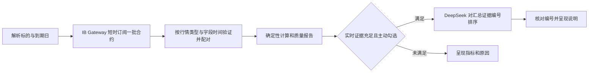

# FinPilot 期权链分析

工作台的「期权分析」按需从本地 IB Gateway 采集美股和 ETF 的 USD 标准期权。一次提交选择一个到期日，围绕标的参考价抽样 3 至 13 档行权价，最多请求 26 个看涨和看跌合约。界面展示实际返回的报价、成交量、未平仓量、IV、Greeks、行情类型与本地接收时间。缺字段时保留空值。每批数据带有独立的快照编号。

## 本机启动

1. 登录 IB Gateway，在 API 设置中启用 socket 客户端和 Read-Only API。确认本机端口。本次实测为 `127.0.0.1:4002`。应用只允许配置回环地址，使用独立且非零的 client ID。
2. 在 FinPilot 虚拟环境安装 `requirements-options.txt`。在本机 `.env` 设置 `IBKR_ENABLED=true`、`IBKR_PORT=4002`、`IBKR_CLIENT_ID=67`。已有相同 client ID 的客户端时，选择一个空闲 ID。默认 `IBKR_MARKET_DATA_TYPE=1`。
3. 启动 FinPilot，在 `/workspace?view=options` 填入 `AAPL`，留空到期日表示选择链中最近可用到期日。点「获取行情并分析」开始采集。网关状态显示的是 TCP 端口探测，实际合约解析和行情可用性要在采集时验证。
4. 对实时权限不足的账户，可在界面明确选择「允许延迟」后重试。IBKR 仍可能为有权限的标的返回实时类型。实时及冻结数据取决于标的和期权的 API 行情授权，市场闭市时也可能缺少双边报价。 [IBKR API 行情说明](https://www.interactivebrokers.com/docs/tws-api/doc/md/introduction) · [IBKR 行情类型](https://interactivebrokers.github.io/tws-api/market_data_type.html)

```powershell
.\.venv\Scripts\python.exe -m pip install -r requirements-options.txt
.\.venv\Scripts\python.exe -m uvicorn app.main:app --host 127.0.0.1 --port 8000
```

## 数据和工作流



`ib-async==2.1.0` 实现 IBKR TWS socket 协议。适配器用底层客户端解析股票合约和 `reqSecDefOptParams`，再为明确的期权组合开临时订阅。默认实时请求，实际类型取自 IBKR 回调。结束或报错时清理订阅并断开。行情读取代码只发送合约定义和行情请求。每次最多一批，采集有 20 秒总超时，合约行情采集窗口约 3.6 秒。 [IBKR 期权合约发现](https://interactivebrokers.github.io/tws-api/options.html) · [IBKR 行情字段](https://interactivebrokers.github.io/tws-api/tick_types.html) · [ib-async 项目](https://github.com/ib-api-reloaded/ib_async)

工作流采用 LangGraph 文档中的固定步骤与条件路由模式。Python 管理采集、计算、质量门槛和输出校验。模型只在末端对已计算的证据排序。 [LangGraph 工作流与 Agent](https://docs.langchain.com/oss/python/langgraph/workflows-agents)

采集时间为本地服务收到回调的 UTC 时间。成交时间只在 IBKR 提供对应字段时单独保留。实时质量门槛要求确认实时行情、30 秒内收到的标的双边中间价、至少两档同步配对且覆盖至少一半请求行权价，以及至少一项可用的价格或成交量证据。30 秒是本地接收时效阈值，不能测量交易所到工作台的真实延迟。延迟、冻结、混合与未确认行情保留可算指标并标明类别。

| 指标 | 计算依据 | 解读边界 |
| --- | --- | --- |
| 看跌/看涨成交量 | 同到期、同档、同类行情的两侧合约成交量之和相除 | 衡量样本相对活跃度。对冲、平仓、行权相关交易都可能影响比率 |
| 看跌/看涨未平仓量 | 分别累计相同覆盖范围的未平仓量 | 持仓存量具有独立更新周期，不能把接收时间当成建仓时间 |
| 约 25Δ IV 差 | 选择同口径价外看跌和看涨的近 25Δ 合约，报告看跌 IV 减看涨 IV 的百分点差 | 比较两侧相对定价，受供需、报价与采样影响。缺少合格配对时留空 |
| 平值跨式权利金占比 | 同一近平值行权价的两腿报价中间价相加，再除以标的中间价 | 描述权利金尺度。宽价差或不同步时留空 |

上述指标作为该批合约的活动和定价线索。它们无法单独识别主动成交方向，也不足以判断市场整体情绪、未来涨跌或交易胜率。 [Cboe 对成交量比率偏差的分析](https://www.cboe.com/insights/posts/how-early-exercise-order-flow-impacts-equity-option-put-call-ratios/) · [CME 对 IV 偏斜的说明](https://www.cmegroup.com/education/courses/introduction-to-cvol/introduction-to-cvol-skew)

## API 和云端解读

`GET /api/options/status` 返回网关配置、依赖、端口状态和云端模型是否已配置。`POST /api/options/analyze` 接收以下参数。省略 `market_data_type` 时采用服务端默认值。1 为实时，2 为冻结，3 为允许延迟，4 为允许延迟冻结。

```json
{"symbol":"AAPL","expiry":null,"radius":1,"market_data_type":3,"interpret_with_llm":false,"language":"zh"}
```

响应包含 `snapshot`、`snapshot_id`、`analyzed_at`、`quality`、`metrics`、`signals`、`caveats` 与 `interpretation`。路由由本地服务提供，不把行情写入聊天数据库。接口契约可在 `/docs` 查看。

用户在行情许可允许时可以主动勾选 API 解读。现有 DeepSeek API 接收汇总比率、覆盖率和范围说明。账户身份、原始合约报价、标的代码、到期日和时间戳留在本机。模型返回少量证据编号，服务端检查编号并呈现相应的本地说明。验证失败时保留所有确定性分析。 [DeepSeek JSON 输出](https://api-docs.deepseek.com/guides/json_mode/) · [IBKR 行情许可](https://www.interactivebrokers.com/en/accounts/forms-and-disclosures-market-data.php)

## 2026 年 11 月 11 日验收

- 服务端 88 项测试通过，包含数据覆盖、配对、缺失与零值、过期与混合模式、订阅清理、请求校验、云端字段隔离及输出验证。`reports/tests_v6.xml`
- Edge 使用 320、390、1440px 三组视口和受控行情响应，通过 13 项界面检查。`reports/options_browser_v6.json`
- 真实 IB Gateway 完成 AAPL 合约发现。模式 1 和 2 返回行情权限不足。显式请求模式 3 和 4 均实际收到延迟数据，覆盖 6 份合约的数据字段，有效双边报价为 0。成交量和未平仓量比率可计算，实时质量门槛未通过。用本地 HTTP 接口另验证了模式 3 和跳过云端解读的行为。`reports/options_gateway_smoke_v6.json`
- 真实 `deepseek-flash` 使用合成汇总指标通过 API 返回了有效证据编号。此次测试没有传输账户行情。`reports/options_cloud_smoke_v6.json`

```powershell
.\.venv\Scripts\python.exe -m pytest -q
.\.venv\Scripts\python.exe scripts/check_options_browser.py
.\.venv\Scripts\python.exe -m scripts.check_options_live --symbol AAPL --modes 1 3
```
