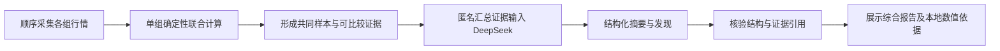

# FinPilot 期权联合分析

期权分析现在把整批合约的成交、持仓分布、报价条件和隐含波动率放在同一份报告中解释。单个到期日会生成综合发现和分歧，多组标的或到期日可以在一次提交中对照。原有报价与指标保留为报告依据。

## 使用方式

打开 `/workspace?view=options`。单组模式使用原有标的、到期日、行权价范围和行情类型。联合模式每行填一组标的与可选到期日，最多四组。相同标的和到期日不能重复提交。留空到期日时沿用 IBKR 链中最近可用到期日。

每组行情按顺序采集。报告保留各自的采集时间、行情类型和返回时距采集结束的秒数。组合中某组取数失败时，其余已成功报告继续显示，失败组单独列出诊断码。如果留空到期日与另一条显式日期最终解析到同一合约范围，后解析的重复组会以 `duplicate_resolved_contract_scope` 标记并排除。

在行情许可允许时勾选 API 解读，可让现有 DeepSeek 生成综合摘要、主要发现、相互冲突的证据、条件情景和局限。延迟及冻结数据可用于有明确时点的描述性分析。实时质量状态仍独立展示。

## 联合计算

| 分析部分 | 实现内容 | 阅读方法 |
| --- | --- | --- |
| 报价条件 | 同模式近期双边报价覆盖、买卖价差相对中间价的中位数、宽价差数量 | 了解定价证据的覆盖和显示报价紧密程度 |
| 成交分布 | 按成对行权价累计看涨与看跌成交量，保留全部并列峰值和样本集中占比 | 查看活动集中在哪些抽样区域 |
| 持仓分布 | 以相同方法读取未平仓量存量的分布 | 结合成交分布观察期间活动与存量结构 |
| 成交和持仓共同样本 | 对完全相同的行权价及两侧合约比较看跌成交占比、看跌持仓占比和百分点差 | 将统计口径差异显式呈现，查看两类结构是否偏向不同侧 |
| 波动率结构 | 条件满足时计算近平值两侧平均 IV，以及同 Greek 口径各点相对平值 IV 的差 | 查看相对定价的形状及样本缺口 |
| 信号呼应与分歧 | 联合比较成交侧、持仓侧和近 25Δ IV 差 | 报告哪些证据支持同侧描述，哪些观察并存但不一致 |
| 跨组对照 | 保留每组自身覆盖范围、报价覆盖、价差、看跌成交占比和可用平值 IV | 在各自样本范围内比较，不汇总不同标的的原始数量 |
| 同标的到期结构 | 对不同到期日的合格平值 IV 比较远期减近期的波动率百分点差 | 只在合约类别、币种、乘数、Greek 口径、行情类型和接收时间等满足条件时显示 |

每条本地发现都关联证据编号。编号可以定位到对应的指标、单位、样本范围和解释。原始合约表让使用者进一步核对行权价与合约字段。

当前筛选规则以字段本地接收时间为准，默认检查三十秒内的数据，同一统计配对的接收差不超过十秒。近平值 IV 要求行权价距标的中间价在百分之一内，两侧 Delta 的绝对值在约零点三五到零点六五之间，并使用一致的 Greek 口径。用于波动率结构的报价相对价差最多百分之三十。跨到期日比较还要求两个平值点的价内外程度差不超过一个百分点。这些是本实现的质量筛选阈值。

## 模型如何形成综合报告



服务端按白名单构造匿名组和汇总证据。输入包含覆盖率、占比、数量、价差或 IV 等可用聚合指标，组使用 `g0`、`g1` 等编号。匿名关系字段说明两组是否属于同一标的、到期顺序及 IV 是否可比。账户身份、原始合约报价、标的代码、到期日和具体行权价留在本机。

模型返回包含 `summary`、`observations`、`conflicts`、`scenarios` 和 `limitations` 的 JSON。摘要、发现、分歧和情景必须引用实际输入的证据编号。服务端检查引用和结构，要求至少两条观察和一条条件情景，并检查模型正文中自行生成的数字或百分号。匿名组编号可以用于指代样本，展示时由本机还原标的和到期日。具体数值由界面从本地证据呈现。首次校验失败时最多请求一次修复，仍未通过则保留已计算的联合报告和数值。模型文字的因果解释需要结合对应证据阅读，引用通过校验不能证明每一句解释都正确。

## 指标口径与解读范围

成交量记录期间活动，未平仓量由清算后配对开平仓统计。成交量超过未平仓量并不能单独识别新增仓位。未平仓量峰值标记样本集中位置，不能单凭该位置推出市场支撑、阻力或持有者方向。 [OCC/OIC 对未平仓量和流动性的说明](https://www.optionseducation.org/referencelibrary/faq/general-information)

看跌和看涨合约都有买卖双方。提前行权相关活动也可能影响成交量比率，因此报告使用相对活动与相对定价的描述，并保留相互冲突的证据。 [Cboe 对提前行权与成交量比率的分析](https://www.cboe.com/insights/posts/how-early-exercise-order-flow-impacts-equity-option-put-call-ratios)

不同到期日的权利金包含不同时间长度，不能直接用权利金大小解释波动率期限结构。此实现使用满足口径条件的近平值 IV，并保留各组的采集时间。 [CME 波动率期限结构工具说明](https://www.cmegroup.com/tools-information/quikstrike/quikstrike-volatility-term-structure-tool-user-guide.html)

报价价差反映显示报价的紧密程度。可成交容量还需要报价数量和订单簿深度。本项目的联合报告使用当前抽样数据，未引入历史分位、逐笔成交方向、账户持仓方向或新闻情绪来源。

## API

`POST /api/options/analyze` 保留原有请求格式，并在结果中增加 `collective` 和 `capture_age_seconds`。

`POST /api/options/batch` 接收最多四组请求，共用行权价范围、行情类型、语言和模型解读选择。

```json
{
  "items": [{"symbol": "AAPL", "expiry": null}, {"symbol": "MSFT", "expiry": null}],
  "radius": 3,
  "market_data_type": 3,
  "interpret_with_llm": false,
  "language": "zh"
}
```

响应包含 `reports`、`failures`、`comparison`、`interpretation`、`completed_at` 和 `requested_items`。每组成功结果保留原来的快照、指标和质量信息。批量模型解读在取数完成后统一发起综合请求，引用或结构校验失败时最多再发起一次修复请求。

## 复验

```powershell
.\.venv\Scripts\python.exe -m pytest -q tests/test_options_collective_workflow.py
```

上述工作流测试使用合成行情和受控模型响应，覆盖联合请求、统一生成与有界修复、字段隔离、部分失败、重复与数量限制、延迟快照描述，以及非法引用和数值正文被拒绝时的结果保留。

## 本轮验证记录

2026 年 11 月 11 日，服务端完整测试通过 112 项。联合工作流的 12 项测试使用合成快照和受控模型响应，包含匿名组在中文正文中出现时的解析、解析后重复组排除、非法因果归因被拒绝及有界修复。完整结果保存在 `reports/tests_v7.xml`。

Edge 的联合界面检查在 320、390 和 1440 像素视口通过 16 项检查，包含综合报告优先呈现、分布和流动性、结构化模型文本、单组及跨组证据跳转、批量提交、部分失败、原始合约展开和英文重开。浏览器中使用受控 API 响应。报告保存在 `reports/options_collective_browser_v7.json`。

真实只读 IB Gateway 验证顺序采集了 AAPL 和 MSFT。两组实际行情类型均为延迟，各自生成了描述性联合发现，比较报告可用。该项验证没有调用云端模型。记录保存在 `reports/options_collective_gateway_v7.json`。

真实 `deepseek-flash` 使用两组匿名合成汇总指标生成并通过校验的报告，包含一份综合摘要、四条观察、两条条件情景和五条局限。模型把不同活动结构与相同 IV 读数解释为共存模式，并保留数据不足以解释成因的边界。此次报告的分歧列表为空。本次云端输入使用合成证据，记录保存在 `reports/options_collective_cloud_v7.json`。

```powershell
.\.venv\Scripts\python.exe scripts/check_options_collective_browser.py
.\.venv\Scripts\python.exe -m scripts.check_options_collective_live
```

增加 `--cloud-fixture` 会改为使用合成汇总指标调用当前配置的 DeepSeek，并按账户规则产生 API 费用。

模型生成与修复共享六十秒截止时间，超时后仍返回本地联合分析。最新一次真实 HTTP 联合请求也收到了两组数据，但可用字段较少，系统把比较状态下调为依据不足。此结果与较早采集的描述性报告分别保留在网关验证记录中。
